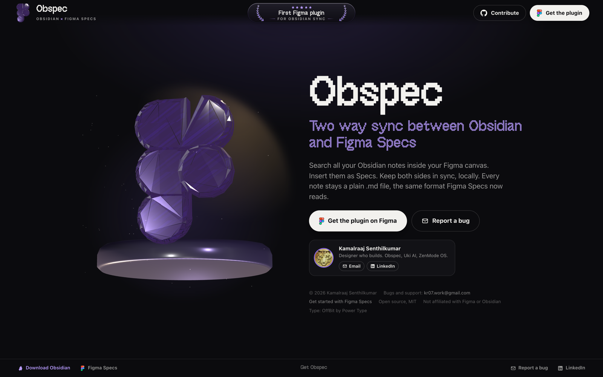
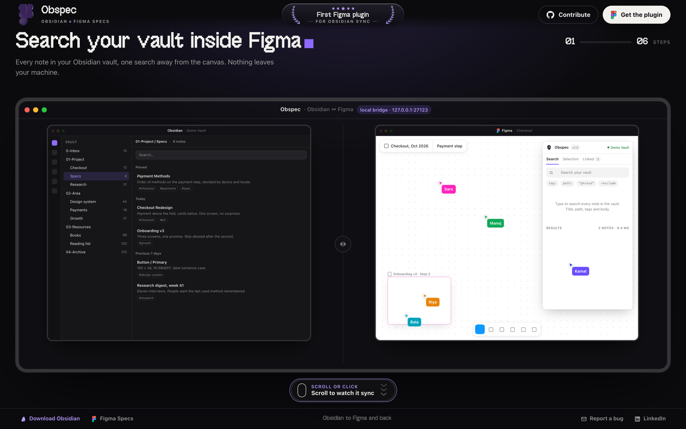
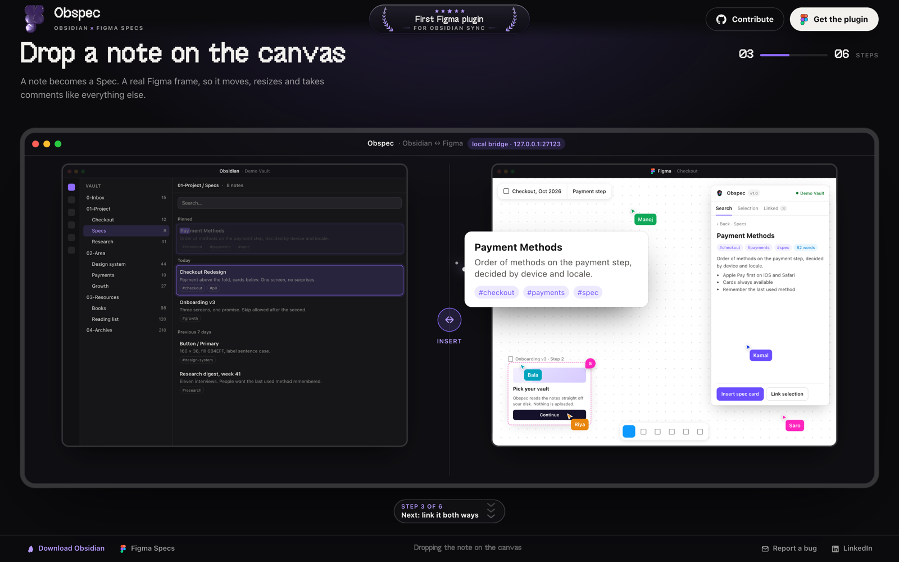
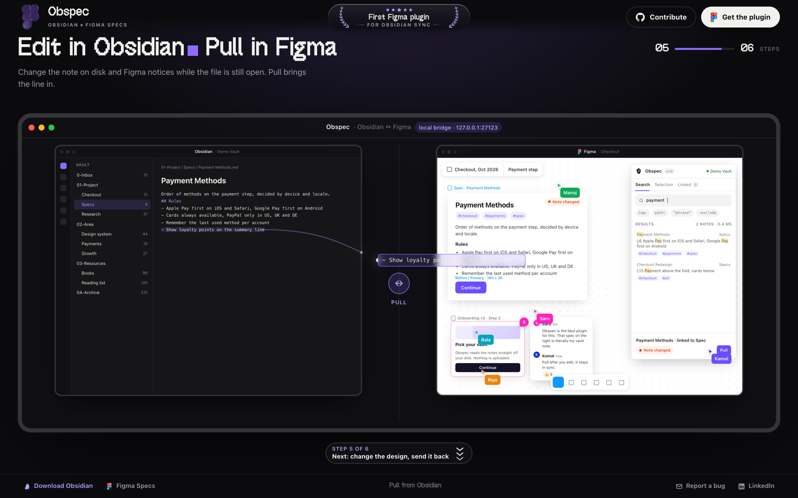

<p align="center">
  <a href="https://kamal007olica.github.io/obspec/"></a>
</p>

<h1 align="center">Obspec</h1>
<p align="center"><b>Obsidian × Figma Specs.</b> Search your vault from inside Figma, drop notes onto the canvas as Specs, and keep both sides in sync. Nothing leaves your machine.</p>
<p align="center">
  <a href="https://kamal007olica.github.io/obspec/">Website</a> ·
  <a href="#run-it">Run it</a> ·
  <a href="#local-preview-no-figma-needed">Preview without Figma</a> ·
  <a href="mailto:kr07.work@gmail.com?subject=Obspec%20bug%20report">Report a bug</a>
</p>
<p align="center">
  
  
  
</p>

---

## What it looks like

| Search the vault inside Figma | Drop a note on the canvas |
| --- | --- |
|  |  |

| Edit in Obsidian, pull in Figma |
| --- |
|  |

The site at **https://kamal007olica.github.io/obspec/** plays this whole flow as you scroll: six steps, then the stone.

**Obsidian ↔ Figma, both ways.** Search your vault from inside Figma, drop any note onto the canvas as a spec card, link layers to notes, and keep the two in sync — note edits show up in Figma live, and design changes can be sent back into the note.

Nothing leaves your machine: the plugin talks to a tiny local bridge that indexes your vault.

```
Figma plugin (UI + sandbox)  ⇄  Obspec Bridge (localhost:27123)  ⇄  your Obsidian vault (.md files)
```

## Features (deliberately few)

| | What | Where |
| --- | --- | --- |
| **Search** | grep-style search over every note: title, path, tags, body. Snippets with highlights, `tag:` `path:` `"phrase"` `-exclude` filters, keyboard-driven. | Search tab |
| **Preview** | rendered markdown, wikilinks (clickable), backlinks, tags, open in Obsidian. | tap a result |
| **Insert / Link** | *Insert spec card* renders the note as a clean auto-layout frame; *Link selection* attaches a note to any layer. | note view |
| **Two-way sync** | status per linked layer: In sync · Note changed · Design changed. *Pull* rebuilds the card / marks the note read. *Send to Obsidian* writes size, fills, copy, component props and a Figma deep link into the note's `## Design` section (creating the note if needed). | Selection & Linked tabs |

## Run it

```bash
npm install
npm run build

# 1. start the bridge against your vault (keep the terminal open)
node bridge/dist/cli.js --vault "~/Documents/My Vault"      # or: npx obspec-bridge --vault …

# 2. in Figma: Plugins → Development → Import plugin from manifest… → pick manifest.json
```

The plugin connects to `http://127.0.0.1:27123` by default; change it under ⚙ Settings. Add `--token <secret>` to the bridge and paste it in Settings if you want auth on top of the loopback bind.

## Local preview (no Figma needed)

```bash
npm run preview      # → http://127.0.0.1:5177
```

Runs the **real plugin UI** and the **real bridge** (against a scratch copy of `examples/vault`) with a mock Figma document. The right rail has five one-click use-case emulations that drive the UI exactly like a user would:

1. Search the vault → open a note → insert a spec card
2. Select a layer → link it to a note
3. Edit the note in Obsidian → status flips to *Note changed* → Pull
4. Select a component → Send to Obsidian → note created with frontmatter + Design table
5. Change the design → *Design changed* → re-send updates the note

`npm run emulate` runs the same five scenarios in headless Chrome and writes screenshots + `report.json` to `preview/shots/`.

## Develop

```bash
npm run watch        # rebuild plugin, bridge and harness on change
npm test             # bridge, search, markdown and note-generation tests
npm run typecheck
```

### Layout

```
manifest.json          Figma plugin manifest (dynamic-page, networkAccess → localhost only)
src/plugin/            sandbox: code.ts (messages, links), speccard.ts, snapshot.ts
src/ui/                plugin UI: ui.ts (state + views), bridge.ts (HTTP/SSE), markdown.ts, app.css
src/shared/            protocol.ts (every cross-boundary type), notegen.ts (markdown written to the vault)
bridge/src/            vault.ts (indexer + fs.watch), search.ts, markdown.ts (frontmatter/wikilinks), server.ts, cli.ts
preview/               serve.mjs, index.html, harness.ts (mock Figma sandbox + scenarios)
examples/vault/        sample Obsidian vault used by the preview and tests
tests/                 node:test suites (run via scripts/test.mjs)
```

### Bridge API

| Method | Path | Notes |
| --- | --- | --- |
| GET | `/health` | vault name, path, note count |
| GET | `/search?q=&limit=` | ranked results with snippets and highlight ranges |
| GET | `/note?path=` | full note incl. frontmatter, outlinks, backlinks, content hash |
| GET | `/notes?limit=` | recent notes (path, title, mtime, tags, hash) |
| PUT | `/note` | `{ path, content, ifHash? }` — create/overwrite, 409 on stale hash |
| PATCH | `/note` | `{ path, frontmatter?, section?, ifHash? }` — merge frontmatter, replace an H2 section |
| GET | `/events` | Server-Sent Events: `created` / `changed` / `deleted` |

Links are stored on nodes as plugin data (`obspec:link`) with the note's content hash and the layer's design fingerprint, which is how sync state is computed without any server-side state.

## Notes & limits

- `figma.fileKey` is only exposed to private/org plugins; without it the note's `figma_url` is omitted (everything else works).
- Spec cards are a readable mirror, not a markdown renderer: headings, lists, quotes, code and tables are kept; images become `[image: …]`.
- The bridge binds to `127.0.0.1` and only allows the Figma plugin origin (`null`), `*.figma.com` and localhost via CORS.

## Website

`site/` is a single static page (OffBit display type, Three.js for the obsidian gem) and deploys to GitHub Pages from `main` through `.github/workflows/pages.yml`. Open `site/index.html` in a browser to work on it; there is no build step.

## Contributing

Issues and pull requests are welcome. For a bug, the fastest route is an issue with the Figma version, OS, and the bridge's console output; or email kr07.work@gmail.com.

## License

[MIT](LICENSE) © 2026 Kamalraaj Senthilkumar. Not affiliated with Figma or Obsidian.
